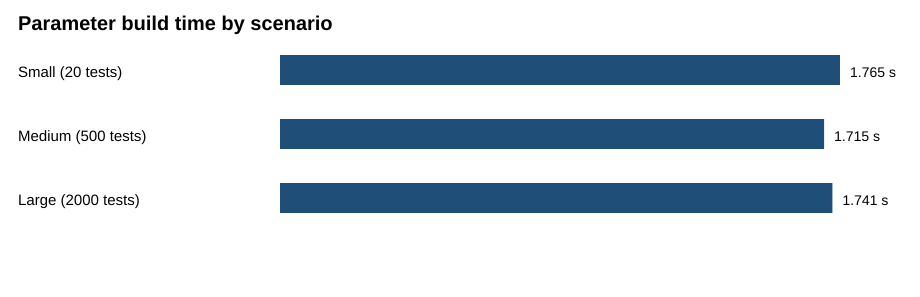

# Parameter build-time benchmark

| Scenario | Variants | Signals | Invalid values | Disabled functions | Test cases | Build time |
| --- | ---: | ---: | ---: | ---: | ---: | ---: |
| Small | 2 | 10 | 1 | 1 | 20 | 1.765 s |
| Medium | 10 | 50 | 2 | 2 | 500 | 1.715 s |
| Large | 20 | 100 | 3 | 2 | 2000 | 1.741 s |

The large scenario creates 2,000 CAN-signal test cases in one parameter file.

